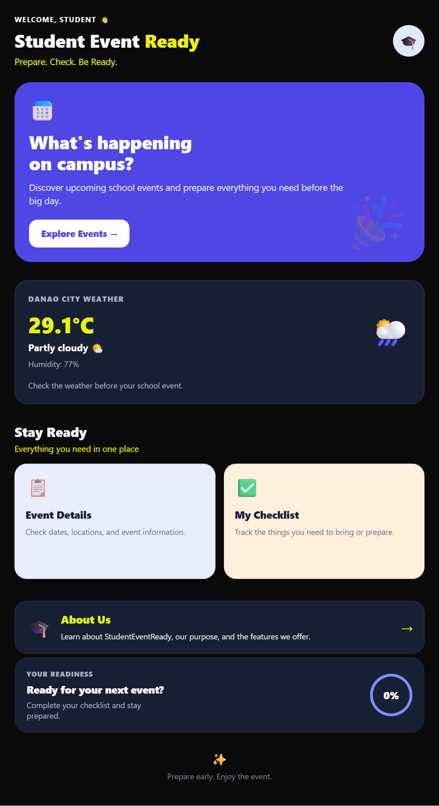
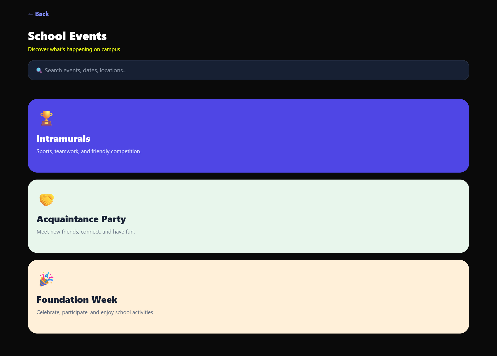
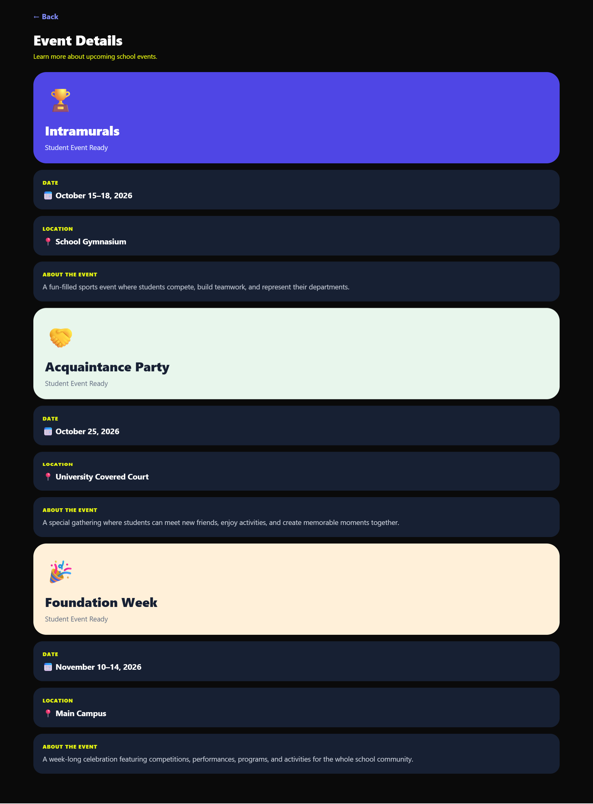
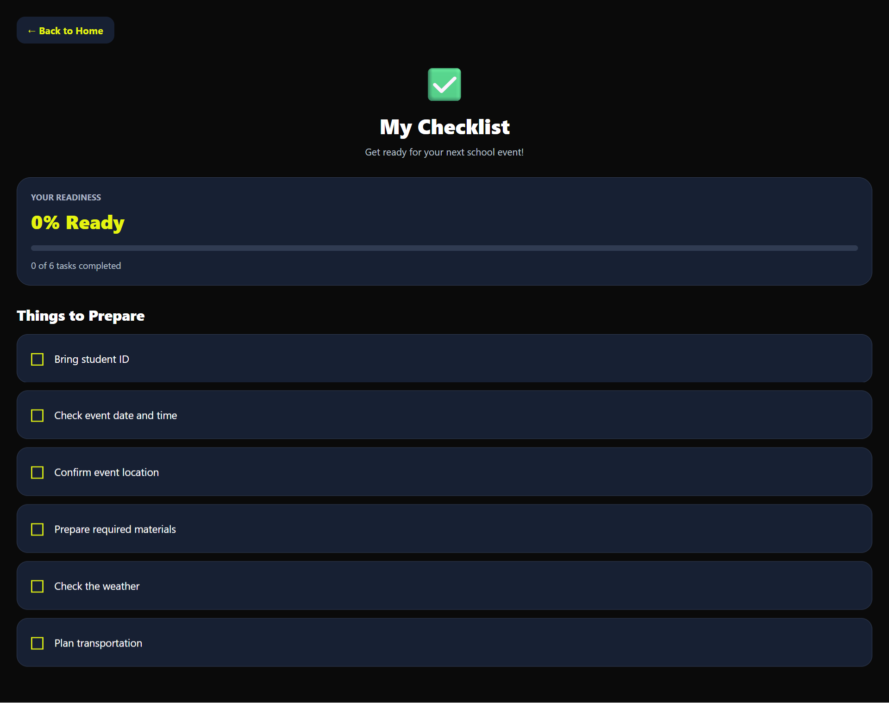
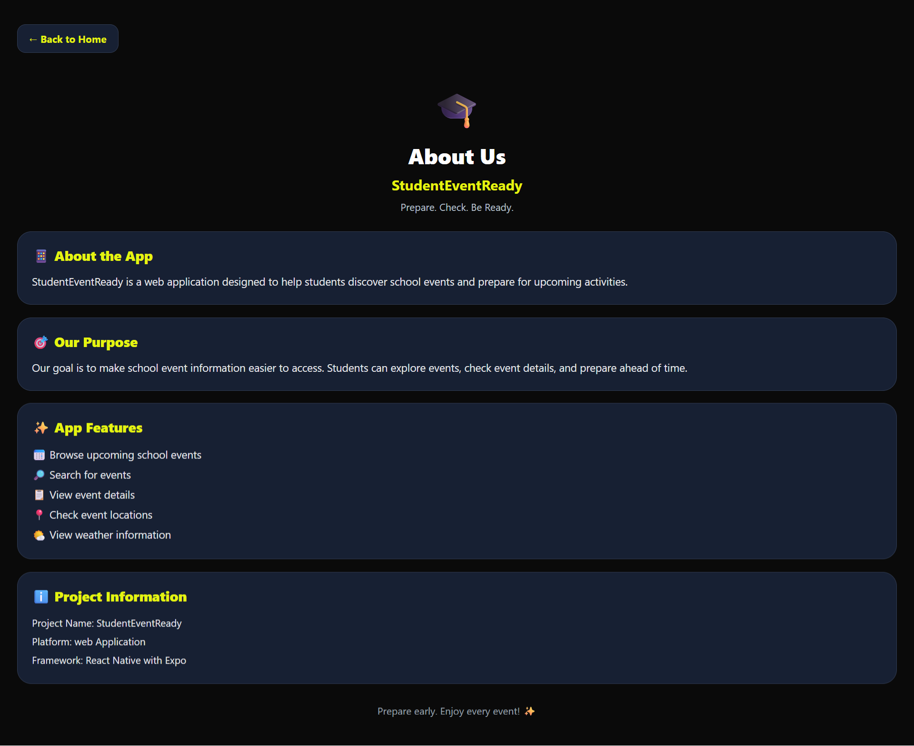

# StudentEventReady

**Prepare. Check. Be Ready.**

## Project Description

StudentEventReady is a student group project built with React Native and Expo. It helps students explore sample school events and prepare for upcoming activities through event search, event details, an interactive preparation checklist, and a current weather feature.

The application uses Expo Router for screen navigation. Event information is stored locally in the app, while the weather feature retrieves current weather information from the Open-Meteo API using fixed coordinates for Danao City, Cebu.

The project can be run in a supported development environment, including a web browser through Expo's web platform.

## Project Objectives

- Provide a simple way for students to browse and search sample school events.
- Display information about school events.
- Help students prepare for activities using an interactive checklist.
- Display current weather information that may help students plan for an event.
- Practice concepts learned in class, including React Native components, state management, effects, API requests, and file-based navigation.

## Main Features

### Home Screen

- Introduces StudentEventReady and its tagline.
- Provides navigation to the app's main sections.
- Displays a weather card with temperature, relative humidity, and a weather description.
- Uses a dark visual theme with yellow accents.

### Events Screen

- Displays sample school events.
- Includes a search field to filter the event list.
- Provides navigation to event-related screens.

### Event Details Screen

- Displays sample school event information.
- Includes event dates, locations, and descriptions.

### Preparation Checklist

- Includes preparation tasks such as bringing a student ID, checking the event date and location, preparing required materials, checking the weather, and planning transportation.
- Lets users mark tasks as complete.
- Displays a completion count and progress percentage.
- Shows a completion message when all tasks are checked.
- Checklist progress is temporary and resets rather than being permanently saved.

### About Screen

- Explains the app's purpose and features.
- Displays basic project information.
- Includes a button to return to the Home screen.

### Current Weather

- Retrieves current weather information from the Open-Meteo API.
- Uses the Fetch API to request weather data.
- Uses React's `useEffect` to load weather information when the Home screen mounts.
- Displays temperature, relative humidity, and a description based on the weather code.
- Uses fixed coordinates for Danao City, Cebu.
- Requires an internet connection to retrieve current weather information.

## Screenshots

The following screenshots demonstrate the application's main screens.

### Home Screen



### Events Screen



### Event Details Screen



### Preparation Checklist



### About Screen



## Technologies Used

- **React Native** — for building the app interface.
- **Expo** — for developing and running the application.
- **Expo Router** — for file-based navigation between screens.
- **TypeScript / TSX** — for the screen files.
- **React `useState`** — for managing interface and checklist state.
- **React `useEffect`** — for handling the weather request when the Home screen loads.
- **Fetch API** — for requesting weather data from Open-Meteo.
- **Open-Meteo API** — for current weather information.
- **Git and GitHub** — for source control and collaboration.

## Project Structure

```text
StudentEventReady/
├── app/
│   ├── _layout.tsx
│   ├── index.tsx
│   ├── event.tsx
│   ├── eventdetails.tsx
│   ├── checklist.tsx
│   └── about.tsx
├── assets/
├── screenshots/
│   ├── home.png
│   ├── events.png
│   ├── event-details.png
│   ├── checklist.png
│   └── about.png
├── app.json
├── package.json
├── package-lock.json
├── tsconfig.json
└── README.md
```

- `app/_layout.tsx` — sets up the app's stack navigation.
- `app/index.tsx` — Home screen and weather feature.
- `app/event.tsx` — Events screen and event search.
- `app/eventdetails.tsx` — Event Details screen.
- `app/checklist.tsx` — interactive preparation checklist.
- `app/about.tsx` — About screen.
- `assets/` — application images and other assets.
- `screenshots/` — screenshots used in the README.
- `README.md` — project documentation.

## Requirements / Prerequisites

Before running the project, install:

- [Node.js](https://nodejs.org/) and npm.
- [Git](https://git-scm.com/).
- A terminal such as Git Bash on Windows.
- An internet connection for dependency installation and the weather feature.

## Installation and Setup

1. Clone the public repository:

   ```bash
   git clone https://github.com/alanlabajo696-hub/StudentEventReady.git
   ```

2. Open the project folder:

   ```bash
   cd StudentEventReady
   ```

3. Install the dependencies:

   ```bash
   npm install
   ```

4. Start the Expo development server:

   ```bash
   npx expo start
   ```

5. Follow the instructions displayed in the terminal to run the application in a supported development environment.

### Run on the Web

To start the web version, run:

```bash
npx expo start --web
```

If Expo reports that a web dependency is missing, follow its installation instructions and try again.

## How to Use the Application

1. Open the app and start from the Home screen.
2. Open the Events section to browse sample school events.
3. Use the search field to filter the displayed events.
4. Open Event Details to view sample event information.
5. Open the Preparation Checklist and mark tasks as complete.
6. Visit the About screen to learn about the application.
7. Check the weather card on the Home screen for current weather information for Danao City, Cebu.

## Team Contributions

The project was developed collaboratively by five group members.

- **Alan Labajo** — Home screen, project integration, and weather/API feature using `useEffect`.
- **Myle Gervise** — Events screen and event search.
- **Jay** — Event Details screen and related navigation.
- **Greshiel** — About screen.
- **Greg** — Interactive preparation checklist, with testing and documentation support.

## Current Limitations

- Event information is sample data stored locally in the application.
- Events are not retrieved from a school database or live events API.
- The Event Details screen displays sample event information defined in the code.
- Checklist progress is temporary and is not permanently saved.
- Weather information uses fixed coordinates for Danao City, Cebu; the app does not automatically detect a user's location.
- The weather feature requires an internet connection.
- The project may require further testing and refinement before real-world deployment.

## GitHub Repository

[StudentEventReady on GitHub](https://github.com/alanlabajo696-hub/StudentEventReady)

The repository is public and can be viewed on GitHub.